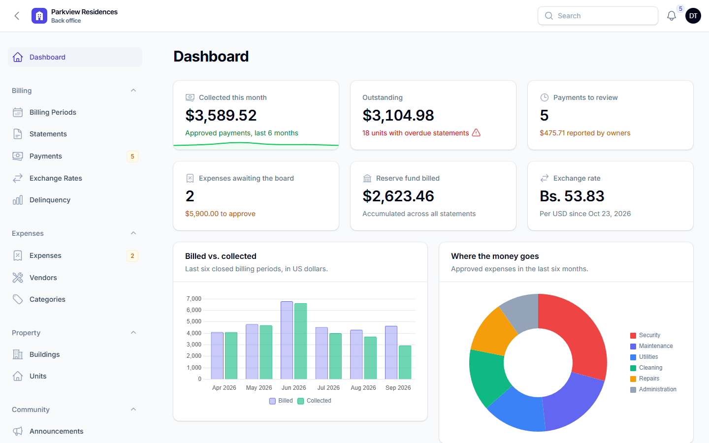
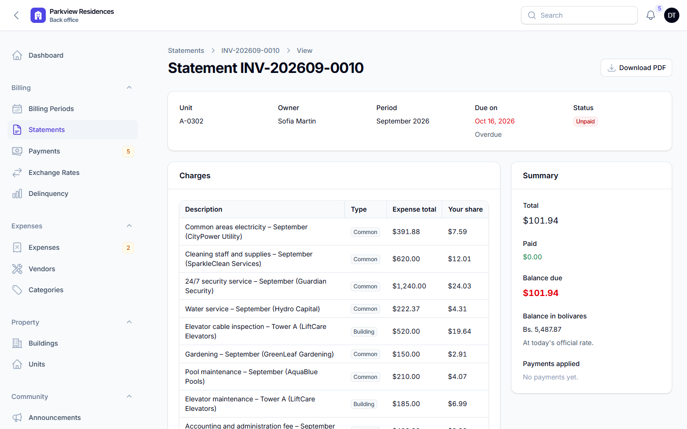
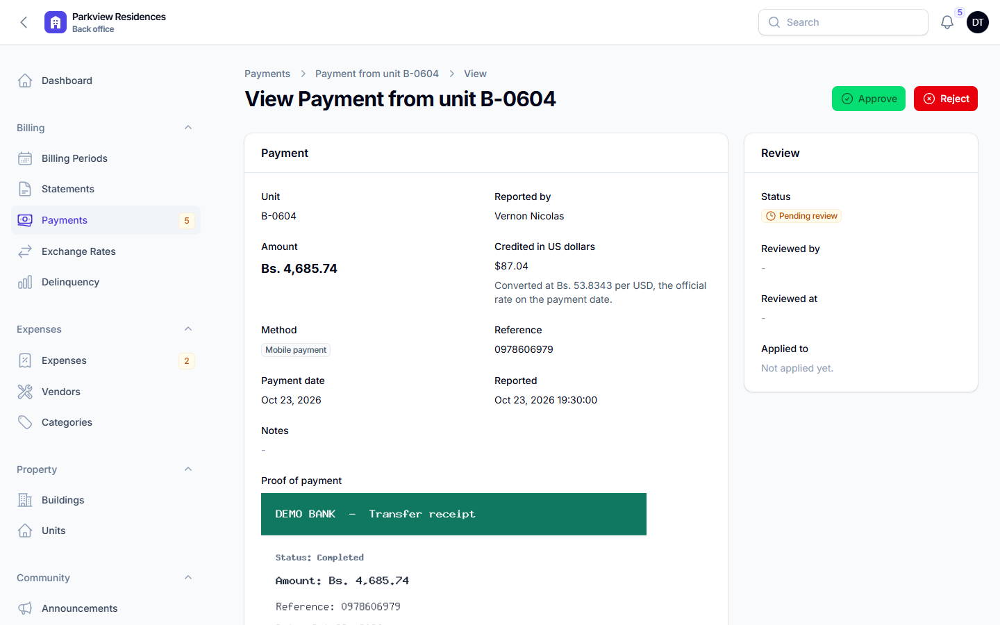
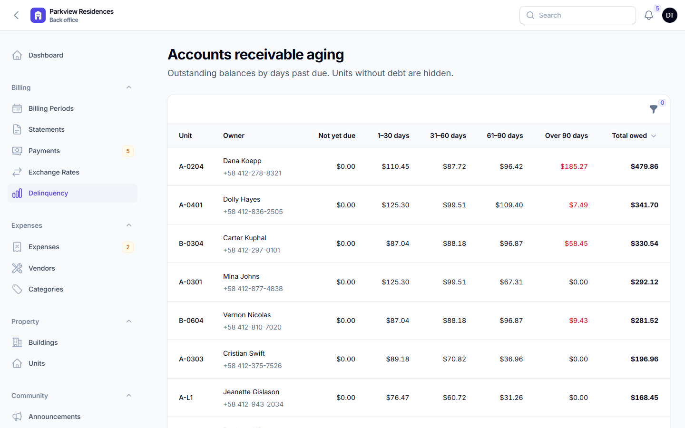
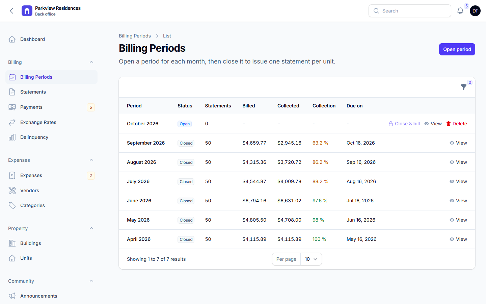
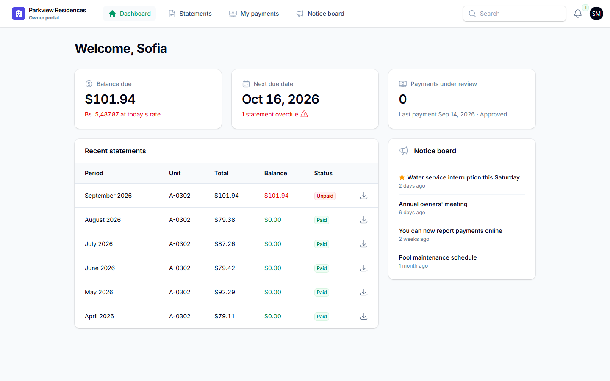
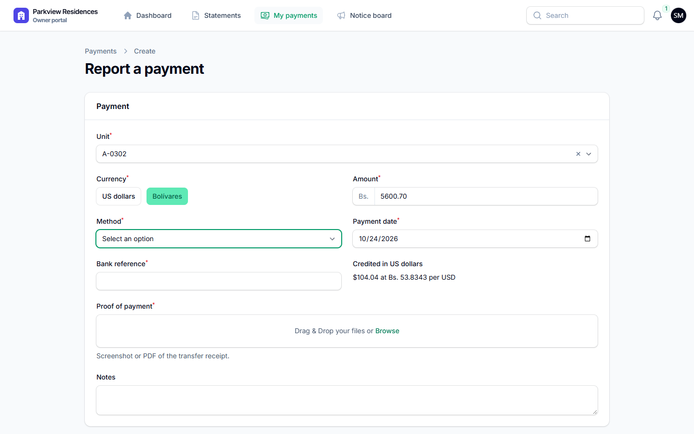
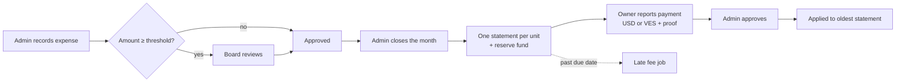
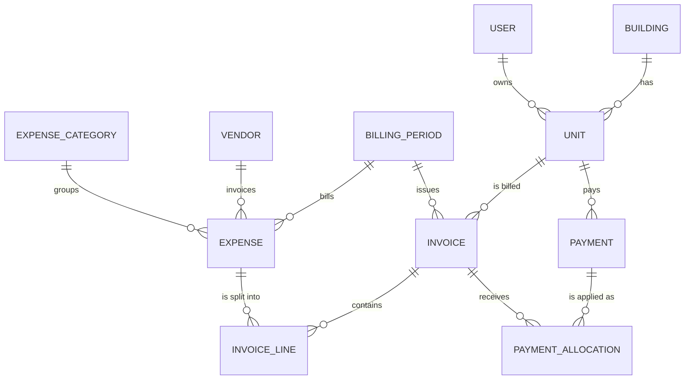

# Condominium Manager

[](https://github.com/Stefanyvl2210/condominium-manager/actions/workflows/ci.yml)


Back office and owner portal for a residential condominium. It turns the monthly
expenses of the buildings into one statement per unit, split by ownership share,
and lets owners pay in US dollars or Venezuelan bolívares.



## Highlights

- **Billing by ownership share.** Closing a month splits every approved expense
  across the units: condominium-wide expenses by ownership share, building
  expenses among that building's units only, and unit charges in full. The
  reserve fund is added on top, and the split never loses or invents a cent.
- **Dual currency.** Statements are issued in USD. Bolívar payments are
  converted with the official exchange rate of the payment date, and every
  statement shows the balance in both currencies.
- **Payments with proof.** Owners report a transfer with a screenshot from the
  portal; the administrator approves it and the money is applied to the oldest
  statement first. Overpayments stay as credit for the next statement.
- **Board approval.** Expenses above a configurable threshold wait for a board
  member's sign-off. The administrator who records an expense cannot approve it.
- **Late fees and aging.** A scheduled command charges the late fee once on
  overdue statements. The aging report groups debt into 1–30, 31–60, 61–90 and
  90+ days.
- **Two Filament panels.** `/admin` for administrators and board members,
  `/portal` for owners, with policies and query scoping so owners only ever see
  their own units.
- **PDF statements, email and in-app notifications**, and a notice board.

## Try it

Run the project locally (below) with `APP_DEMO=true` and use the one-click
sign-in buttons on the home page or on either login screen.

| Role | Email | Can |
|---|---|---|
| Administrator | `admin@example.com` | Manage units, owners, vendors, expenses, billing periods and payments |
| Board member | `board@example.com` | See everything, approve or reject large expenses. Also owns unit A-0101 |
| Owner | `owner@example.com` | See their statements, download PDFs, report payments, read notices |

All demo accounts use the password `password`. The seeder builds six months of
history: 2 towers, 50 units, daily exchange rates, about 270 payments, some
late payers, five payments waiting for review and two expenses waiting for the
board.

## Screenshots

| | |
|---|---|
|  |  |
| **Statement** with each expense and the unit's share | **Payment review** with the owner's receipt |
|  |  |
| **Accounts receivable aging** | **Billing periods** and collection rate |
|  |  |
| **Owner portal** | **Reporting a payment in bolívares** with live conversion |

## How a month is billed



For a unit with a 2 % share in Tower A, a month with $1,000 of
condominium expenses and $200 of Tower A elevator maintenance (Tower A holds
48 % of the condominium) produces:

| Line | Amount |
|---|---|
| Condominium expenses: 2 % of $1,000 | $20.00 |
| Tower A expenses: 2 / 48 of $200 | $8.33 |
| Reserve fund: 10 % of $28.33 | $2.83 |
| **Total** | **$31.16** |

Business rules live in plain PHP classes under `app/Actions`, so they are tested
without the UI:

| Rule | Where |
|---|---|
| Split cents with the largest remainder method | `app/Support/ShareAllocator.php` |
| Close a billing period and issue statements | `app/Actions/Billing/CloseBillingPeriod.php` |
| Charge late fees | `app/Actions/Billing/ApplyLateFees.php` |
| Convert and record a payment | `app/Actions/Payments/SubmitPayment.php` |
| Approve or reject a payment | `app/Actions/Payments/ReviewPayment.php` |
| Apply credit to the oldest statements | `app/Actions/Payments/ApplyUnitCredit.php` |
| Route large expenses to the board | `app/Actions/Expenses/RecordExpense.php` |

## Data model



`condominiums` holds the settings (reserve fund, late fee, payment term, approval
threshold), `exchange_rates` the daily VES/USD rate and `announcements` the
notice board.

## Technical decisions

- **Money is stored as integer cents.** Splitting, percentages and currency
  conversion use integer arithmetic with explicit rounding (`app/Support/Money.php`).
- **Billing history is immutable.** Statements are generated, never edited; a
  billed expense can no longer change. Corrections go into the next period.
- **Actions instead of fat models or controllers.** Filament pages call the same
  actions as the tests and the seeder.
- **Authorization in policies.** Board members are read-only except for expense
  review; owners are limited by both policies and per-panel query scoping.
- **Realistic demo data.** The seeder replays the real actions while travelling
  through time, so the demo data follows the same rules as production data.

## Running locally

Requirements: PHP 8.3 with `intl`, `gd`, `zip` and `pdo_mysql`, Composer,
Node 20+ and MySQL 8. [Laragon](https://laragon.org) on Windows covers all of
them.

```bash
git clone git@github.com:Stefanyvl2210/condominium-manager.git
cd condominium-manager
cp .env.example .env            # set DB_* for your MySQL server
mysql -uroot -e "CREATE DATABASE condominium"
composer setup                  # installs, migrates, seeds and builds assets
php artisan serve
```

Open <http://localhost:8000>. Re-seed the demo at any time with
`php artisan migrate:fresh --seed`.

Useful commands:

| Command | What it does |
|---|---|
| `composer check` | Pint, Larastan and the test suite |
| `composer test` | Pest tests (SQLite in memory) |
| `php artisan billing:apply-late-fees` | Charge late fees on overdue statements (scheduled daily) |
| `php artisan demo:reset` | Wipe and re-seed the demo (only when `APP_DEMO=true`; scheduled nightly) |
| `php artisan schedule:work` | Run the scheduler locally |

Emails go to the log by default (`MAIL_MAILER=log`). Set `APP_DEMO=false` on any
site that holds real data.

## Deployment

The demo is designed for [Laravel Cloud](https://cloud.laravel.com): compute and
MySQL scale to zero, uploads go to a private bucket and the scheduler resets the
demo every night. See [docs/deployment.md](docs/deployment.md) for the
step-by-step setup.

## Tests and quality

- **Pest**: 96 tests covering the billing rules, payments, late fees,
  permissions per role, data isolation between owners and the Filament pages.
- **Larastan** at level 6 and **Pint**, enforced in GitHub Actions.

## Tech stack

Laravel 13 · Filament 5 (Livewire 4) · PHP 8.3 · MySQL 8 · Tailwind CSS 4 ·
Pest 4 · Larastan · DomPDF

## History

The first version was written in 2019 with Laravel 6. It was rebuilt in 2026 on
the current stack, keeping the original domain: units, monthly charges, vendors
and their payments.
